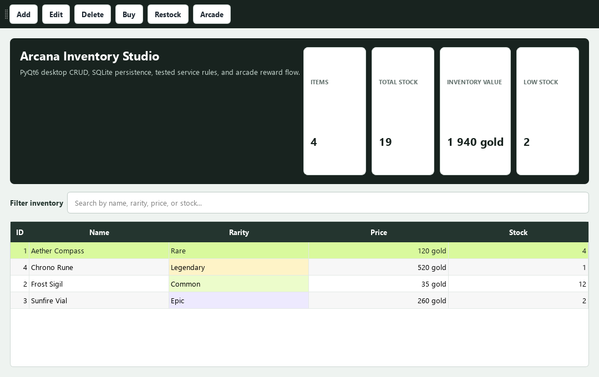
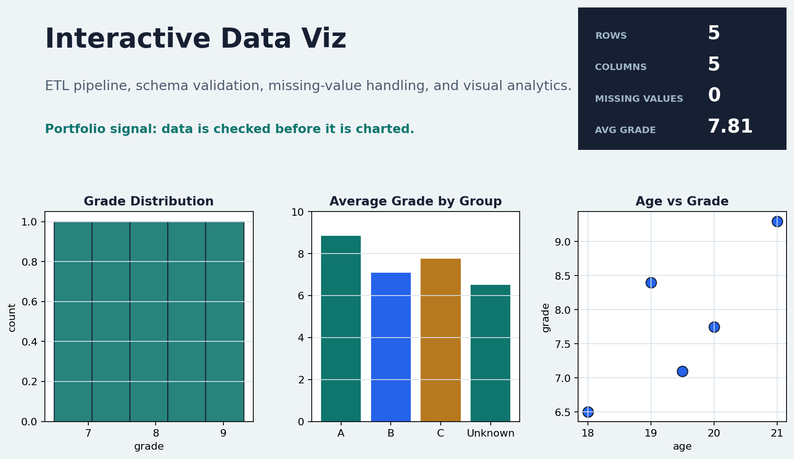
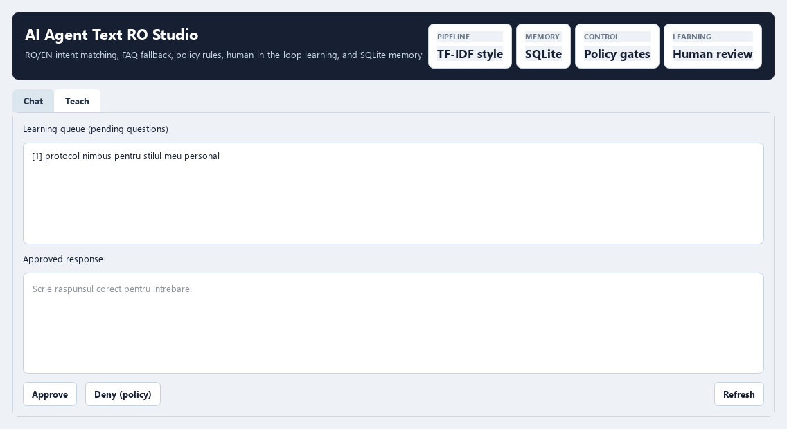

# Portfolio Index

Public index of my Python projects.
Focus areas: deterministic logic, data quality, desktop apps, and testable architecture.

## Professional Profile
- Technical QA Engineer (Junior+) with hands-on Python automation mindset.
- Building deterministic, testable applications instead of black-box demos.
- Comfortable with data validation, API testing workflows, desktop tooling, and CI.
- Secondary track: Blender 3D portfolio for visual design execution and presentation quality.

## Quick Review Path (15 Minutes)
1. [Python Live QA Studio](https://github.com/teogame3d-alt/pylive-qa-studio) - live diagnostics, traceback explanation, syntax learning coach, privacy-safe output.
2. [QA Automation API Suite](https://github.com/teogame3d-alt/qa-automation-api-suite) - dedicated API automation tests with CI.
3. [AI Agent Text RO](https://github.com/teogame3d-alt/ai-agent-text-ro) - user-trainable RO/EN agent, SQLite memory, PyQt6 UI.
4. [Interactive Data Viz](https://github.com/teogame3d-alt/interactive-data-viz) - ETL-style cleaning with validation and interactive analytics.
5. [PyQt6 Magic Shop](https://github.com/teogame3d-alt/pyqt6-magic-shop) - desktop CRUD app with layered architecture and tests.
6. [Digital Library](https://github.com/teogame3d-alt/digital-library) - concise OOP and persistence fundamentals demo.

## Visual Review

Screenshots are included to make the technical review faster. UI projects show real interfaces;
CLI/API projects use honest evidence boards that summarize architecture, tests, and behavior.

  
  

  
  
  

  

## Project Matrix

| Project | Role of Project | Main Skills Demonstrated | Quality Signals |
| --- | --- | --- | --- |
| [Python Live QA Studio](https://github.com/teogame3d-alt/pylive-qa-studio) | Developer tool / QA learning assistant | AST diagnostics, traceback explanation, syntax coaching, privacy-safe output | tests, CI, screenshots, security/privacy notes |
| [QA Automation API Suite](https://github.com/teogame3d-alt/qa-automation-api-suite) | API test automation | pytest, requests, contract checks, CI pipelines | dedicated QA scope |
| [AI Agent Text RO](https://github.com/teogame3d-alt/ai-agent-text-ro) | User-trainable AI agent concept | learning queue, approved answers, policy rules, SQLite memory | tests, CI, architecture docs |
| [Interactive Data Viz](https://github.com/teogame3d-alt/interactive-data-viz) | Data cleaning + visual analytics | pandas ETL, data contracts, metrics, visual explainability | tests, CI, modular structure |
| [PyQt6 Magic Shop](https://github.com/teogame3d-alt/pyqt6-magic-shop) | Offline desktop business app | PyQt6, repository/service layers, SQLite | tests, CI, separation of concerns |
| [Digital Library](https://github.com/teogame3d-alt/digital-library) | Compact OOP baseline | domain modeling, CLI flows, JSON persistence | tests, clear scope |

## Portfolio Boundaries

- Each public repository has one primary role; I avoid publishing duplicate demos that prove the same skill twice.
- Game/visual QA work is treated as a future track only when it can be shown safely: dataset validation, model evaluation, training configuration, and reports.
- Public computer-vision demos should not include live input automation, private browser profiles, local paths, logs, model checkpoints, or machine-specific artifacts.
- Brand direction: TeoGame3D, with a practical QA/dev tooling focus rather than scattered experiments.

## Technical Stack Snapshot
- Python
- PyQt6
- SQLite
- pandas / NumPy
- matplotlib / mplcursors
- pytest + GitHub Actions

## System Health

- Package-style projects install with `python -m pip install -e .`.
- Automated tests are available through `python -m pytest`.
- UI projects have smoke-checked PyQt6 startup paths.
- Data projects have smoke-checked report/dashboard generation.
- Public files are scanned for local machine paths, tokens, and private environment references.

## Notes
- Repositories are intentionally scoped for clarity and fast technical review.
- Each project README includes problem, solution, setup, and test commands.

## Build vs Polish Transparency
- Core features in each repo are supported by readable code, tests, documentation, and screenshots where useful.
- Public repositories are kept focused so a recruiter can understand the project role quickly.
- New public projects are added only when they demonstrate a distinct skill that the current portfolio does not already show.

## 3D Portfolio (Blender)
- Public site: https://teogame3d-site.pages.dev/
- Focus: stylized + realistic renders, animated previews, and branded presentation.

